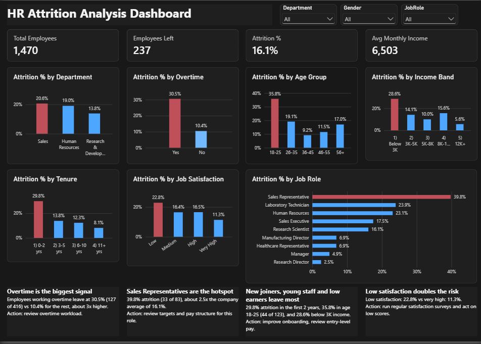

# HR Attrition Analysis Dashboard (Power BI)

## Objective
Find out who is leaving the company and why, using HR data.

## Dataset
IBM HR Analytics Employee Attrition & Performance, a public sample dataset from Kaggle (1,470 employees, 35 columns).

Source: https://www.kaggle.com/datasets/pavansubhasht/ibm-hr-analytics-attrition-dataset

## Tools
Power BI (Power Query, DAX)

## Process
1. Loaded the CSV into Power BI and checked data quality (no errors or empty values).
2. Removed columns with a single value (EmployeeCount, Over18, StandardHours).
3. Created Age Group, Income Band, Tenure Band, Attrition Flag and Satisfaction Level columns in Power Query.
4. Wrote DAX measures: Total Employees, Employees Left, Attrition %, Avg Monthly Income.
5. Built 4 KPI cards, 7 charts, 3 slicers (Department, Gender, Job Role) and 4 insight boxes.

## Key Findings
- Overall attrition is 16.1% (237 of 1,470 employees).
- Overtime: 30.5% attrition (127 of 416) vs 10.4% without overtime, about 3x higher.
- Sales Representatives: 39.8% attrition (33 of 83), about 2.5x the company average.
- First 2 years of tenure: 29.8%. Age 18-25: 35.8% (44 of 123). Income below 3K: 28.6%.
- Low job satisfaction: 22.8% vs 11.3% for Very High.

## Recommendations
- Review overtime workload.
- Look at targets and pay structure for Sales Representatives.
- Improve onboarding and review entry-level pay.
- Run regular satisfaction surveys and act on low scores.

## Limitations
- This shows patterns, not proven causes. For example, new employees often have lower pay, so tenure and income overlap.
- The 56+ age group is small (about 47 employees), so its rate should be read with caution.

## Files
- `HR_Attrition_Dashboard.pbix`: the Power BI file
- `dashboard.png`: dashboard screenshot

## Author
Nikki Mishra | [LinkedIn](https://www.linkedin.com/in/nikkimishra12)
